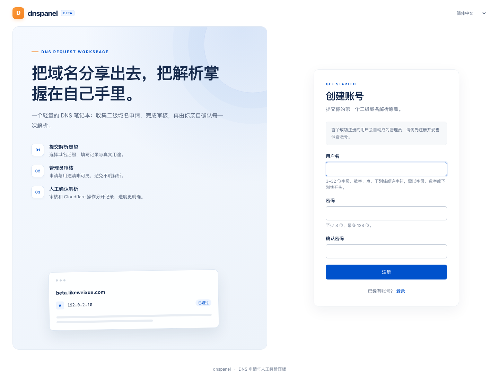

# dnspanel

一个轻量的二级域名 DNS 申请与人工审核面板。

dnspanel 不直接修改 DNS，也不调用 Cloudflare API。它更像一本“DNS 笔记本”：用户提交二级域名解析申请，管理员审核后到 Cloudflare 手动添加记录，再回到面板确认解析完成。



## 功能特性

- **首个用户自动成为管理员**，后续注册均为普通用户
- 用户可提交申请并查看审核、解析进度
- 支持 **A、AAAA、CNAME、TXT** 记录
- 管理员可管理用户状态、域名后缀和全部 DNS 申请
- 审核通过与人工解析完成分开记录，状态清晰可追踪
- 同一完整域名存在待审核或已通过申请时，自动阻止重复占用
- 中文界面默认启用，可切换 English
- Cloudflare 风格响应式界面，适配桌面与移动端
- 使用 JSON 文件存储，无需 MySQL、Composer 或前端构建工具

## 工作流程

1. 管理员添加可供申请的域名后缀，例如 `likeweixue.com`。
2. 用户选择后缀，填写 `beta`、解析记录和用途，申请 `beta.likeweixue.com`。
3. 管理员查看记录与用途，选择通过或拒绝。
4. 申请通过后，管理员手动到 Cloudflare 添加 DNS 记录。
5. 管理员回到面板点击“标记已解析”，用户即可看到最终状态。

状态流转：

```text
待审核 → 已通过 / 待解析 → 已解析
   └────→ 已拒绝
```

## 技术栈

- PHP 8.0+（已在 PHP 8.3 验证）
- 原生 HTML、CSS、JavaScript
- JSON 文件存储，带文件锁和原子写入
- Docker（可选，用于快速本地运行）

## 快速开始

### 方式一：使用 Docker

在项目根目录执行：

```bash
docker run --rm -d \
  --name dnspanel \
  --user "$(id -u):$(id -g)" \
  --publish 127.0.0.1:8080:8000 \
  --volume "$PWD:/var/www/html" \
  --workdir /var/www/html \
  php:8.3-cli php -S 0.0.0.0:8000 -t public public/index.php
```

访问 [http://127.0.0.1:8080](http://127.0.0.1:8080)。

停止本地服务：

```bash
docker stop dnspanel
```

### 方式二：使用本机 PHP

确保已安装 PHP 8.0 或更高版本，然后执行：

```bash
php -S 127.0.0.1:8000 -t public public/index.php
```

访问 [http://127.0.0.1:8000](http://127.0.0.1:8000)。

> 首次使用时，请先注册管理员账号，再登录后台添加域名后缀。对外开放网站前，务必先完成首个管理员注册。

## 数据存储

运行数据位于 `storage/`：

| 文件 | 内容 |
| --- | --- |
| `users.json` | 用户、密码哈希、角色和账号状态 |
| `domains.json` | 可供申请的域名后缀及启用状态 |
| `requests.json` | DNS 申请、审核记录和人工解析状态 |
| `app.lock` | 运行时生成的文件锁，不需要备份 |

请确保 PHP 运行用户对 `storage/` 具有读写权限。备份时保留三个 JSON 文件即可；恢复数据后请检查文件权限。**真实运行数据包含用户信息、密码哈希和申请内容，请勿将其提交到公开仓库。**

## 部署注意事项

- **Web 文档根目录必须指向 `public/`**，不要将整个项目根目录公开，否则可能暴露存储文件。
- PHP 内置服务器仅建议用于本地预览；正式部署请使用 Nginx 或 Apache，并将动态请求转发到 `public/index.php`。
- 正式环境应启用 HTTPS，并限制 `storage/` 的读写权限。
- JSON 存储适合申请量较小、以人工审核为主的使用场景；如果需要高并发写入或复杂查询，建议迁移到数据库。
- 本项目不会保存 Cloudflare Token，也不会自动检测 DNS 是否生效；“已解析”表示管理员已确认手动操作完成。

## 项目结构

```text
dnspanel/
├── public/
│   ├── index.php          # 页面入口与路由
│   └── assets/            # CSS 与 JavaScript
├── src/
│   ├── bootstrap.php      # Session、安全响应头与 CSRF
│   ├── JsonStore.php      # JSON 文件锁与原子写入
│   ├── app.php            # 认证、申请、审核等业务逻辑
│   └── views.php          # 页面渲染与中英文文案
├── storage/               # JSON 运行数据，不应公开访问
├── docs/preview.png       # README 页面预览图
└── README.md
```

## 安全说明

dnspanel 使用 `password_hash()` 保存密码，提供 Session 固定攻击防护、CSRF 校验、服务端权限检查、DNS 输入校验和 HTML 输出转义。所有注册、申请和审核写入均经过统一文件锁，避免并发覆盖及首个管理员竞争。

## License

本项目基于 [MIT License](LICENSE) 开源。
